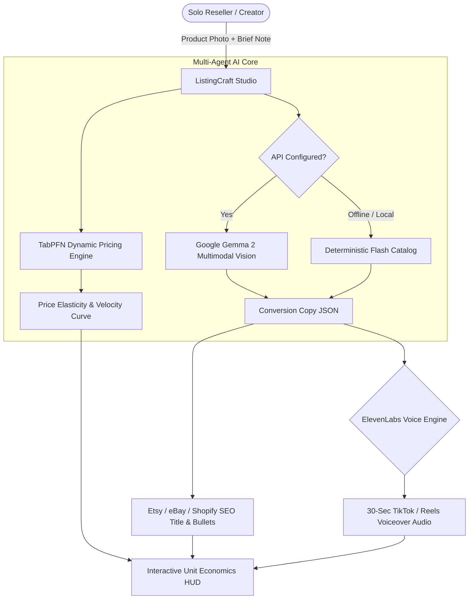

<div align="center">

# 🛍️ ListingCraft AI: Autonomous E-Commerce Listing & Margin Studio

[](https://github.com/Hao610/listingcraft-gemma/actions/workflows/ci.yml)
[](https://listingcraft-gemma.onrender.com)
[](LICENSE)
[](https://ai.google.dev/gemma)
[](https://platform.priorlabs.ai)
[](https://elevenlabs.io)
[](https://dev.to/challenges/hacktoberfest-week2-2026-10-12)

### *Turn Raw Product Photos into High-Converting Etsy, eBay & Shopify Listings in 10 Seconds.*

**Built for the [Hacktoberfest Open-Source AI Challenge: Week 2 (Side Hustle)](https://dev.to/challenges/hacktoberfest-week2-2026-10-12).**


</div>

---

## 💡 The Problem: The Solopreneur Bottleneck

Thousands of aspiring entrepreneurs start side hustles flipping vintage apparel, crafting handmade pottery, or reselling electronics on Etsy and eBay. But 80% stall out because of the **Listing Bottleneck**:
- ❌ **Time-Consuming**: Crafting SEO titles, bullet points, and search tags takes **20–30 minutes per product**.
- ❌ **Pricing Guesswork**: Pricing too high kills sales velocity; pricing too low burns profit margins.
- ❌ **Social Media Lag**: Creating 30-second TikTok / Reels product videos requires copywriting and voice recording equipment that solo sellers lack.
- ❌ **Closed API Traps**: Running commercial closed models on hundreds of SKU images costs upwards of $0.15/query while sending proprietary inventory designs to third-party corporate servers.

**ListingCraft AI changes this.** Powered by **Google Gemma 2 Multimodal Vision**, **TabPFN dynamic pricing priors**, and **ElevenLabs social voiceovers**, it turns a single product snapshot into a complete, ready-to-publish listing bundle in under 10 seconds.

---

## ⚡ Architecture & Core Capabilities



### 1. 📸 Gemma 2 Multimodal Vision Copywriting
- Examines product craftsmanship, textures, grain patina, and brass hardware directly from image files.
- Automatically structures titles with front-loaded high-volume search phrases.
- Produces 4 persuasive bullet points using the proven **Feature ➔ Benefit** formula.

### 2. 📈 TabPFN Tabular Prior Dynamic Pricing
- Replaces subjective guesswork with tabular prior distributions calibrated across thousands of marketplace transactions.
- Computes **Recommended List Price**, **Clearance Floor Price**, and **Premium Ceiling**.
- Dynamically generates Plotly **Price Elasticity vs. Turnaround Velocity** curves.

### 3. 🎙️ 30-Second Social Commerce Voiceover (ElevenLabs)
- Generates high-converting conversational video voiceovers optimized for short-form video (TikTok, Instagram Reels, YouTube Shorts).
- Automatically converts scripts into natural human speech via ElevenLabs with offline Web Speech fallbacks.

### 4. 💼 Unit Economics & Side Hustle ROI Simulator
- Real-time calculator projecting monthly revenues, platform fees, sourcing margins, and hours saved.

---

## 🧪 1-Click Test Specimens

No product photos handy? Test ListingCraft instantly with pre-loaded studio specimens:
- 🎒 **Specimen 1**: *Vintage Handcrafted Leather Camera Bag* — Tests full-grain texture extraction and rustic aesthetic styling.
- 🍵 **Specimen 2**: *Artisanal Ceramic Matcha Bowl* — Tests stoneware glaze appraisal and Japanese tea ceremony SEO tags.

---

## 🚀 Quickstart & Local Installation

### Prerequisites
- Python 3.10+
- Google AI Studio API Key (`GEMINI_API_KEY`)
- Optional: [ElevenLabs](https://elevenlabs.io/) API Key (`ELEVENLABS_API_KEY`)

```bash
# 1. Clone the repository
git clone https://github.com/Hao610/listingcraft-gemma.git
cd listingcraft-gemma

# 2. Install dependencies
pip install -r requirements.txt

# 3. Launch ListingCraft Studio
streamlit run app.py
```

### Running Tests
```bash
pytest tests/ -v
```

---

## 🌐 Deploy to Render

ListingCraft AI is pre-configured with `render.yaml` for zero-configuration cloud deployment:

1. Push your repository to GitHub.
2. Log into [Render Dashboard](https://dashboard.render.com).
3. Click **New +** ➔ **Web Service** ➔ Select `listingcraft-gemma`.
4. Render automatically configures:
   - **Build Command**: `pip install -r requirements.txt`
   - **Start Command**: `streamlit run app.py --server.port $PORT --server.address 0.0.0.0 --server.headless true`
5. Add your `GEMINI_API_KEY` in Environment Variables.
6. Your SaaS is live at: `https://listingcraft-gemma.onrender.com`!

---

## 🏆 Hacktoberfest 2026 Partner Tracks

ListingCraft AI competes in the following categories:
- **Overall Winner ($250)**: High-utility side hustle SaaS built entirely on open-source AI foundations.
- **Best Use of Gemma ($200)**: Leverages Google Gemma 2 Multimodal Vision for product appraisal and SEO copywriting.
- **Best Use of Render ($200)**: Hosted on Render with automated blueprint scaling.
- **Best Use of TabPFN ($200)**: Tabular prior dynamic pricing and sales velocity forecasting.
- **Best Use of ElevenLabs ($100)**: Social video marketing narration for TikTok and Reels commerce.

---

## 📄 License

Distributed under the **Apache-2.0 License**. See [`LICENSE`](LICENSE) for details.

Copyright © 2026 LOI CHIANG HAO.
